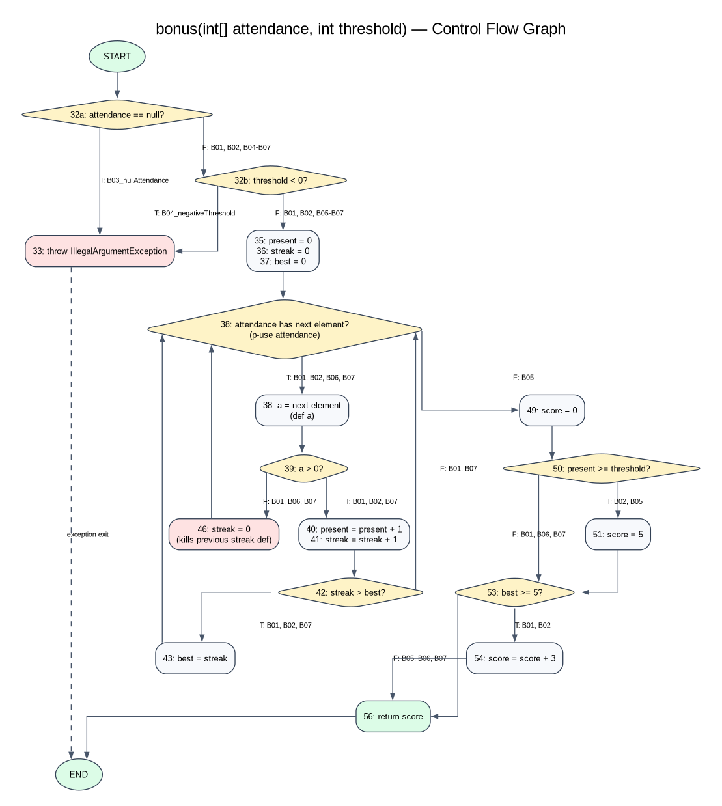

# Лаборатори №10 — Өгөгдлийн урсгалын тест (Definition–Use хосууд)

**Оюутны нэр:** М.Наранбат  
**Оюутны код:** B242270801  
**Хичээл:** F.CSA313 — Программ хангамжийн чанарын баталгаа ба тест (2026)

> **Starter source-ийн тэмдэглэл:** анхны upload-д `DataFlowTargets.java` байгаагүй; хавсаргасан `ScholarshipCalculator.java` болон `pom.xml` нь Lab 9 (`lab09-jacoco`) гэж тэмдэглэгдсэн байсан бөгөөд `._starter`/`._src` нь AppleDouble metadata файлууд байсан. Тиймээс `DataFlowTargets.java`-д Lab 10 handout-ийн method болон заасан 13, 15–20, 31–56 мөрийн бүтэцтэй таарах public Lab 10 copy ашигласан. Энэ нь Teams-ийн анхны `starter.zip`-тэй тулгаж баталгаажуулсан гэсэн үг биш; багшийн эх zip өөр байвал эх файлын diff ба мөрийн дугаарыг заавал шалга. Репод `ScholarshipCalculator.java` оруулаагүй. Эндхүү бүх C мутацийн дараа `DataFlowTargets.java`-г өөрчлөлтгүй буцаасан.

## Ашигласан орчин

`java -version` командын бүрэн гаралт (`results/java-version.txt`):

```text
openjdk version "17.0.21" 2026-10-20
OpenJDK Runtime Environment Temurin-17.0.21+9 (build 17.0.21+9)
OpenJDK 64-Bit Server VM Temurin-17.0.21+9 (build 17.0.21+9, mixed mode, sharing)
```

`mvn -version` командын бүрэн гаралт (`results/mvn-version.txt`):

```text
Apache Maven 3.9.15 (98b2cdbfdb5f1ac8781f537ea9acccaed7922349)
Maven home: /usr/share/apache-maven-3.9.15
Java version: 17.0.21, vendor: Eclipse Adoptium, runtime: /usr/lib/jvm/temurin-17-jdk-amd64
Default locale: en, platform encoding: UTF-8
OS name: "linux", version: "7.0.0-1019-azure", arch: "amd64", family: "unix"
```

Эдгээр нь GitHub Actions-ийн Linux runner дээрээс авсан баталгаажуулалтын орчны гаралт; оюутны өөрийн компьютерийн гаралт биш.

## Хэсэг A — `gcd(x, y)` DU шинжилгээ

`gcd` нь Евклидийн алгоритмаар хамгийн их ерөнхий хуваагчийг олно. 13-р мөрийн method parameters нь `x`, `y`-ийн анхны def. 14-р мөрийн `int tmp;` нь зөвхөн зарлалт тул утгатай def биш. `tmp`-ийн цорын ганц def нь 16-р мөр.

| Мөр | Def | c-use | p-use |
|---:|---|---|---|
| 13 | `x`, `y` | — | — |
| 15 | — | — | `y != 0` |
| 16 | `tmp` | `x`, `y` | — |
| 17 | `x` | `y` | — |
| 18 | `y` | `tmp` | — |
| 20 | — | `x` | — |

T/F нь 15-р мөрийн while нөхцөлийн True/False салаа.

| Хувьсагч | Def мөр | Use мөр | Use төрөл | Def-clear зам | Тест ID | Хамрагдсан |
|---|---:|---|---|---|---|---|
| x | 13 | 16 | c-use | 13 → 15(T) → 16 | G02 | Тийм |
| x | 13 | 20 | c-use | 13 → 15(F) → 20 | G01 | Тийм |
| x | 17 | 16 | c-use | 17 → 18 → 15(T) → 16 | G02 | Тийм |
| x | 17 | 20 | c-use | 17 → 18 → 15(F) → 20 | G02 | Тийм |
| y | 13 | 15(T) | p-use | 13 → 15(T) | G02 | Тийм |
| y | 13 | 15(F) | p-use | 13 → 15(F) | G01 | Тийм |
| y | 13 | 16 | c-use | 13 → 15(T) → 16 | G02 | Тийм |
| y | 13 | 17 | c-use | 13 → 15(T) → 16 → 17 | G02 | Тийм |
| y | 18 | 15(T) | p-use | 18 → 15(T) | G02 | Тийм |
| y | 18 | 15(F) | p-use | 18 → 15(F) | G02 | Тийм |
| y | 18 | 16 | c-use | 18 → 15(T) → 16 | G02 | Тийм |
| y | 18 | 17 | c-use | 18 → 15(T) → 16 → 17 | G02 | Тийм |
| tmp | 16 | 18 | c-use | 16 → 17 → 18 | G02 | Тийм |

p-use-ийн хоёр салааг тусад нь тоолбол 13 мөр; зөвхөн хувьсагч–def–use гурвалаар тоолбол 11 DU хос. `x@13 → 17` хос байхгүй: 17-р мөрөнд `x`-ийг уншихгүй, харин `x`-д шинэ утга оноодог.

### GCD тестүүд

| ID | Тестийн метод | Оролт | Гаралт | Давталт |
|---|---|---|---:|---:|
| G01 | `gcd_zeroSecondArgument_coversEntryToExitPairs_13_15_20` | `gcd(7, 0)` | 7 | 0 |
| G02 | `gcd_twoIterations_coversLoopCarriedPairs_15_16_17_18_20` | `gcd(12, 8)` | 4 | 2 |

`gcd(7,0)` нь `x@13 → return@20` болон `y@13 → while@15(F)` хосыг ганцаараа хамарна. Давталт нэг ч удаа ажиллаагүй тул 17-р мөрийн `x` болон 18-р мөрийн `y` тодорхойлолтууд үүсэхгүй. `gcd(12,8)`-ийн төлөвүүд `(12,8) → (8,4) → (4,0)` тул яг хоёр давталт хийнэ. Давталтаар дамждаг `x@17 → 16`, `y@18 → 15/16/17`, `tmp@16 → 18` хосууд G02-оор хамрагдана.

## Хэсэг B — `bonus(attendance, threshold)` бүрэн анализ

### B1. Control Flow Graph

`cfg-bonus.png` диаграмм дахь зангилаанууд эх кодын мөрийн дугаартай. For-each-ийн 38-р мөрийг хоёр үйлдэл болгон загварчилсан: дараагийн элемент байгаа эсэх нь `attendance`-ийн p-use; дараагийн элементийг `a`-д оноох нь `a`-ийн def. Салаа бүрийн ирмэг дээр тухайн замыг гүйцэтгэх бодит JUnit методын нэр/ID тавигдсан. Эх зургийн эх код нь `cfg-bonus.dot`.



Диаграмын ирмэг дээрх B01–B07 түлхүүр бүр нь дараах бодит JUnit методыг заана:

| CFG key | JUnit test method |
|---|---|
| B01 | `B01_allDefs_score49Reaches54_longStreakThenReset` |
| B02 | `B02_allDefs_score51Reaches54_fiveConsecutiveDays` |
| B03 | `B03_nullAttendance_coversAttendanceDefinitionToNullBranch_31_32T` |
| B04 | `B04_negativeThreshold_coversThresholdDefinitionToNegativeBranch_31_32T` |
| B05 | `B05_emptyArray_zeroThreshold_coversFalseLoopAndScoreReturn_38_50_53_56` |
| B06 | `B06_allAbsent_belowThreshold_coversInitialDefsToFalseUses_32_38_39_50_53_56` |
| B07 | `B07_shortStreakAfterBreak_coversBestUpdatedDefinitionToFalseBranch_42_53` |

### B2. Def/Use жагсаалт

| Мөр | Definition (def) | c-use | p-use |
|---:|---|---|---|
| 31 | `attendance`, `threshold` (parameters) | — | — |
| 32 | — | — | `attendance == null`; `threshold < 0` (зөвхөн эхний шалгалт False үед) |
| 35 | `present` | — | — |
| 36 | `streak` | — | — |
| 37 | `best` | — | — |
| 38 | `a` (давталтын итерац бүрт) | — | `attendance`-д дараагийн элемент байгаа эсэх |
| 39 | — | — | `a > 0` |
| 40 | `present` | `present` (баруун тал) | — |
| 41 | `streak` | `streak` (баруун тал) | — |
| 42 | — | — | `streak`, `best` |
| 43 | `best` | `streak` | — |
| 46 | `streak` | — | — |
| 49 | `score` | — | — |
| 50 | — | — | `present`, `threshold` |
| 51 | `score` | — | — |
| 53 | — | — | `best` |
| 54 | `score` | `score` (баруун тал) | — |
| 56 | — | `score` | — |

32-р мөрийн `||` нь short-circuit: `attendance == null` True бол `threshold < 0` operand огт шалгагдахгүй. 40, 41, 54-р мөрийн assignment-д баруун талын хуучин утгыг c-use болгон уншаад дараа нь шинэ def үүсгэнэ.

### B3. DU хосын хүснэгт

T/F нь тухайн p-use нөхцөлийн True/False салаа. 38-р мөрийн T/F нь for-each-д дараагийн элемент байгаа эсэх. `Def-clear` нь заасан def-ээс тухайн use хүртэл хувьсагч дахин тодорхойлогдоогүй замын жишээ.

| Хувьсагч | Def мөр | Use мөр | Төрөл | Def-clear зам | Тест ID | Хамрагдсан |
|---|---:|---|---|---|---|---|
| attendance | 31 | 32(T) | p-use | 31 → 32(T) | B03 | Тийм |
| attendance | 31 | 32(F) | p-use | 31 → 32(F) | B01 | Тийм |
| attendance | 31 | 38(T) | p-use | 31 → 32(F) → 35–37 → 38(T) | B01 | Тийм |
| attendance | 31 | 38(F) | p-use | 31 → 32(F) → 35–37 → 38(F) | B05 | Тийм |
| threshold | 31 | 32(T) | p-use | 31 → 32a(F) → 32b(T) | B04 | Тийм |
| threshold | 31 | 32(F) | p-use | 31 → 32a(F) → 32b(F) | B01 | Тийм |
| threshold | 31 | 50(T) | p-use | 31 → 32(F) → 35–38(F) → 49 → 50(T) | B05 | Тийм |
| threshold | 31 | 50(F) | p-use | 31 → 32(F) → ... → 49 → 50(F) | B01 | Тийм |
| a | 38 | 39(T) | p-use | 38(def a) → 39(T) | B01 | Тийм |
| a | 38 | 39(F) | p-use | 38(def a) → 39(F) | B01 | Тийм |
| present | 35 | 40 | c-use | 35 → 38(T) → 39(T) → 40 | B01 | Тийм |
| present | 35 | 50(T) | p-use | 35 → 38(F) → 49 → 50(T) | B05 | Тийм |
| present | 35 | 50(F) | p-use | 35 → 38(F) → 49 → 50(F) | B06 | Тийм |
| present | 40 | 40 | c-use | 40 → 41–43 → 38(T) → 39(T) → 40 | B01 | Тийм |
| present | 40 | 50(T) | p-use | 40 → ... → 38(F) → 49 → 50(T) | B02 | Тийм |
| present | 40 | 50(F) | p-use | 40 → ... → 38(F) → 49 → 50(F) | B01 | Тийм |
| streak | 36 | 41 | c-use | 36 → 37 → 38(T) → 39(T) → 40 → 41 | B01 | Тийм |
| streak | 41 | 41 | c-use | 41 → 42(T) → 43 → 38(T) → 39(T) → 40 → 41 | B01 | Тийм |
| streak | 41 | 42(T) | p-use | 41 → 42(T) | B01 | Тийм |
| streak | 41 | 42(F) | p-use | 41 → 42(F) | B01 | Тийм |
| streak | 41 | 43 | c-use | 41 → 42(T) → 43 | B01 | Тийм |
| streak | 46 | 41 | c-use | 46 → 38(T) → 39(T) → 40 → 41 | B01 | Тийм |
| best | 37 | 42(T) | p-use | 37 → 38(T) → 39(T) → 40 → 41 → 42(T) | B01 | Тийм |
| best | 37 | 53(F) | p-use | 37 → 38(F) → 49 → 50(F) → 53(F) | B06 | Тийм |
| best | 43 | 42(T) | p-use | 43 → 38(T) → 39(T) → 40 → 41 → 42(T) | B01 | Тийм |
| best | 43 | 42(F) | p-use | 43 → ... → 46 → ... → 41 → 42(F) | B01 | Тийм |
| best | 43 | 53(T) | p-use | 43 → 38(F) → 49 → 50(F) → 53(T) | B01 | Тийм |
| best | 43 | 53(F) | p-use | 43 → 38(F) → 49 → 50(F) → 53(F) | B07 | Тийм |
| score | 49 | 54 | c-use | 49 → 50(F) → 53(T) → 54 | B01 | Тийм |
| score | 49 | 56 | c-use | 49 → 50(F) → 53(F) → 56 | B06 | Тийм |
| score | 51 | 54 | c-use | 51 → 53(T) → 54 | B02 | Тийм |
| score | 51 | 56 | c-use | 51 → 53(F) → 56 | B05 | Тийм |
| score | 54 | 56 | c-use | 54 → 56 | B01/B02 | Тийм |

Нийт 32 DU/p-use салааны тохиолдол хүснэгтэд тусдаа мөрөөр бичигдсэн. p-use-ийн T/F салааг нэг def–use мөр болгон нэгтгэвэл 23 хувьсагч–def–use гурвал болно.

#### Kill ба def-clear замгүй хослолууд

46-р мөрийн `streak = 0` нь өмнө нь 36, 41 эсвэл 46-р мөрөнд үүссэн `streak` def-ийг kill хийж, өөрөө шинэ def үүсгэнэ. Иймээс 41-р мөрийн def-ээс 42/43-р мөрийн use хүрэх зам 46-р мөрөөр дайрвал тухайн өмнөх def-clear зам биш. 41-р мөрийн дараагийн iteration-д хүрэх замд 46-р мөр орсон бол өмнөх 41-ийн def хүчингүй; зөвхөн 46-р мөрийн хамгийн сүүлийн def нь дараагийн 41-р мөрийн c-use-д хүрнэ.

Мөн 41-р мөрийн дараагийн давталтын `streak = streak + 1` өөрөө шинэ def учир `streak@36 → 42/43`, `streak@46 → 42/43` хослол def-clear замгүй; 42/43-д хүрэхээс өмнө 41 дээр заавал дахин тодорхойлогдоно. 43-р мөрийн `best = streak` нь өмнөх best def-ийг kill хийдэг. 51-р мөрийн `score = 5` нь 49-р мөрийн def-ийг kill хийнэ; 54-р мөрийн `score = score + 3` нь уншсаны дараа шинэ score def үүсгэнэ. Kill-ээр тасарсан def–use-г DU pair гэж тооцоогүй.

#### Биелэшгүй хосууд

- `best@37 → 42(F)` биелэшгүй: 37-р мөрийн `best` нь 0 бөгөөд эхний эерэг ирц дээр `streak` 1 болно. Тиймээс 42-р мөр анх хүрэхэд `1 > 0` заавал True, улмаар 43-р мөр 37-р мөрийн def-ийг kill хийнэ.
- `best@37 → 53(T)` биелэшгүй: 37-р мөрийн def хэвээр байвал `best` 0 тул `best >= 5` False. Харин True болохын тулд 43-р мөрөөр best шинэчлэгдсэн байх ёстой.
- `attendance == null` үед 32-р мөрийн short-circuit-ын улмаас `threshold < 0` use хүрэхгүй. Тиймээс нэг гүйцэтгэлд attendance-null болон threshold-negative салааг хамтад нь хамруулах боломжгүй.

### B4. ALL-DEFS ба ALL-DU-PAIRS тестүүд

#### ALL-DEFS — хамгийн цөөн тест

Эхний шатанд `BonusTest` хоёр тесттэй. GCD-ийн хоёр тесттэй нийлээд 4 тест.

| ID | Метод | Attendance | Threshold | Хүлээгдэх үр дүн |
|---|---|---|---:|---:|
| B01 | `B01_allDefs_score49Reaches54_longStreakThenReset` | `{1,1,1,1,1,0,1}` | 8 | 3 |
| B02 | `B02_allDefs_score51Reaches54_fiveConsecutiveDays` | `{1,1,1,1,1}` | 5 | 8 |

Хамгийн багадаа хоёр тест шаардлагатай. 49-р мөрийн `score = 0` def нь зөвхөн 50-р мөрийн False салаагаар амьд үлдэж use-д хүрнэ; 51-р мөрийн `score = 5` def нь 50-р мөрийн True салаагаар үүснэ. Нэг гүйцэтгэл line 50-ын T ба F салааг зэрэг дагах боломжгүй. Иймээс нэг тестээр хоёр score definition-ийг use-д хүргэх боломжгүй. B01 нь `score@49 → 54`, B02 нь `score@51 → 54` хосыг хангана; хоёулаа `score@54 → 56` хосыг хангана.

`results/mvn-verify-alldefs.txt` болон `results/jacoco-alldefs.csv` нь энэ хоёр BonusTest болон хоёр GcdTest ажилласан үеийн бодит Maven/JaCoCo гаралт. All-defs шатанд `Tests run: 4, Failures: 0, Errors: 0, Skipped: 0` гарсан.

#### ALL-DU-PAIRS

Дараагийн шатанд B03–B07 тестүүдийг нэмсэн.

| ID | Метод | Оролт | Threshold | Хүлээгдэх үр дүн |
|---|---|---|---:|---|
| B03 | `B03_nullAttendance_coversAttendanceDefinitionToNullBranch_31_32T` | `null` | 1 | `IllegalArgumentException` |
| B04 | `B04_negativeThreshold_coversThresholdDefinitionToNegativeBranch_31_32T` | `{}` | -1 | `IllegalArgumentException` |
| B05 | `B05_emptyArray_zeroThreshold_coversFalseLoopAndScoreReturn_38_50_53_56` | `{}` | 0 | 5 |
| B06 | `B06_allAbsent_belowThreshold_coversInitialDefsToFalseUses_32_38_39_50_53_56` | `{0,0,0}` | 1 | 0 |
| B07 | `B07_shortStreakAfterBreak_coversBestUpdatedDefinitionToFalseBranch_42_53` | `{1,1,0,1}` | 4 | 0 |

Энэ шатны 9 тест (2 GCD + 7 bonus) бүх жагсаасан DU/p-use салааг хамарна. M2 mutation killer B08-г тусгай C шатанд нэмсэн тул all-pairs-ийн эхний M2 туршилт survive болохыг тусад нь харуулна. Бодит `mvn verify` гаралт `Tests run: 9, Failures: 0, Errors: 0, Skipped: 0`, `BUILD SUCCESS`. `jacoco-allpairs.csv`-д `BRANCH_MISSED=0`, `BRANCH_COVERED=16`, `LINE_MISSED=1`, `LINE_COVERED=23` гэж байна.

### B5. JaCoCo — branch ба DU ялгаа

JaCoCo-ийн бодит CSV тоо:

| Шат | Branch missed | Branch covered | Line missed | Line covered |
|---|---:|---:|---:|---:|
| ALL-DEFS (`jacoco-alldefs.csv`) | 3 | 13 | 2 | 22 |
| ALL-DU-PAIRS (`jacoco-allpairs.csv`) | 0 | 16 | 1 | 23 |
| Эцсийн (`jacoco-final.csv`) | 0 | 16 | 1 | 23 |

Эцсийн `BRANCH_MISSED = 0` буюу 16/16 branch хамралттай. `LINE_MISSED = 1` нь 7-р мөрийн Java implicit constructor; энэ хоёр метод static тул constructor үүсгэн дуудахгүй. All-defs шатанд branch 13/16 (3 салаа дутуу) байсан ч бүх definition-ийг use-д хүргэсэн. Энэ нь all-defs хамралт branch 100% гэсэн үг биш гэдгийг харуулна.

Branch 100% нь DU 100%-ийг батлахгүй. Жишээлбэл B01, B02, B03, B04, B05, B06 нь нөхцөлийн хоёр салааг хамруулж болох ч B07-гүй үед `best@43 → 53(F)` DU хос үлдэнэ: B01/B02-д `best` 5 буюу түүнээс их, B06-д `best` анхны 0 байна. Зөвхөн B07-ийн богино дараалал `best`-ийг 43-р мөрөнд 2 болгосны дараа 53-р мөрийн False салаанд хүргэнэ. Branch хэмжүүр нь салбарласан ирмэгийг тоолдог; аль def тухайн use-д хүрснийг хэмждэггүй.

## Хэсэг C — Fault seeding

Мутаци бүрийг `DataFlowTargets.java` дээр түр хийж `mvn test` ажиллуулаад, дараа нь эх кодыг backup-оос сэргээсэн. Эцсийн source starter хувилбартай ижил.

| Мутаци | Tests run | Failures | Үр дүн | Нотолгоо |
|---|---:|---:|---|---|
| M1 — `streak = streak + 1`-ийг устгах | 9 | 2 | Илэрсэн | `results/mvn-test-M1.txt` |
| M2 — `best = streak` → `best = present` (B08-гүй) | 9 | 0 | Амьд үлдсэн | `results/mvn-test-M2.txt` |
| M2 — B08 нэмсний дараах kill тест | 10 | 1 | Илэрсэн | `results/mvn-test-M2-kill.txt` |
| M3 — ашиглагдаагүй `total` def нэмэх | 9 | 0 | Илрээгүй | `results/mvn-test-M3.txt` |

### M1 — Missing update

41-р мөрийн `streak = streak + 1` update-ийг арилгахад дараалсан ирцийн streak өсөхгүй. B01-ийн хүлээгдэж буй 3 оноо 0 болж (`expected: <3> but was: <0>`), B02-ийн хүлээгдэж буй 8 оноо 5 болно (`expected: <8> but was: <5>`). Энэ хоёр тест M1 мутацийг унагаасан. Log-д `Tests run: 9, Failures: 2` гэж байна.

### M2 — Wrong variable

`best = streak`-ийг `best = present` болгосон эхний хувилбар 9 тестийг давсан (`Tests run: 9, Failures: 0`; `BUILD SUCCESS`). B01-ийн best шинэчлэгдэх эхний урт цуваанд `present == streak == 5`; B02-д тасалдалгүй тул `present == streak` хэвээр. B07-ийн богино жишээнд ч шинэ best үүсэх мөчид эдгээр утга тэнцүү. Иймд all-DU-pairs-ийн бүх хос хамрагдсан боловч энэ өгөгдлөөр буруу хувьсагчийн утга үр дүнд ялгаа гаргаагүй.

B08 нь `attendance={1,0,1,1,1,1}`, `threshold=6` оролтоор ялгааг гаргана. Зөв хувилбарт `present=5`, хамгийн урт `streak=4`, threshold хангагдахгүй, бонусын оноо 0. Мутацид `best=present=5` болж `best>=5` True болж, буруу 3 оноо үүсгэнэ. Иймээс `mvn-test-M2-kill.txt` дахь B08 failure (`expected: <0> but was: <3>`) M2-ийг илрүүлсэн; энэ run `Tests run: 10, Failures: 1`.

### M3 — Dead definition

Давталтын дараа `int total = present + best;` нэмэхэд `total`-д def үүсэх боловч ямар ч use байхгүй. Тиймээс энэ нь dead definition: тестийн ажиглагдах үр дүн өөрчлөгдөхгүй, `mvn test` амжилттай (`Tests run: 9, Failures: 0`). `javac` unused local variable-д заавал анхааруулга гаргадаггүй; IDE/static analysis-ийн “unused local variable / assigned value is never read” төрлийн inspection үүнийг илрүүлэх ёстой. Энэ орчинд IDE inspection-ийг ажиллуулаагүй тул бодит IDE warning-ийг хуулж зохиомлоор оруулаагүй.

## Эцсийн баталгаажуулалт

`results/mvn-verify-final.txt` нь 10 тест амжилттай ажилласан (`Tests run: 10, Failures: 0, Errors: 0, Skipped: 0`; `BUILD SUCCESS`) эцсийн `mvn verify` гаралт. `results/jacoco-final.csv` нь эцсийн JaCoCo CSV (Branch 16/16; Line 23/24). `DataFlowTargets.java`-д түр мутаци үлдээгүй; Git-д эх код starter commit-тэй ижил.

## AI туслахын хэрэглээ

ChatGPT-ийг DU хосын анхны ангилал, тестийн оролт сонгох, CFG-ийн Graphviz эх үүсвэр болон README-ийн бүтэц боловсруулахад ашигласан. Тестийн хүлээгдэх үр дүн болон DU замуудыг бодит эх кодын мөрүүдтэй тулган шалгасан. AI-ийн санал болгосон хүснэгтийг дангаар нь нотолгоо болгоогүй.

## Дүгнэлт

DU анализ нь branch coverage-оос илүү нарийвчлалтайгаар тухайн def-ээс аль use хүрч байгааг, замд дахин тодорхойлолт буюу kill орсон эсэхийг шалгадаг. Branch 100% болсон ч best-ийн 43-р мөрийн def-ээс 53-р мөрийн False use-д хүрэх хос зэрэг орхигдож болохыг B07-ийн жишээ харуулна. Харин DU анализ хийхэд хувьсагч бүрийн def/use цэг, def-clear зам, loop-carried хос болон биелэшгүй салааг гараар тооцоолох шаардлагатай тул илүү үнэтэй. All-defs үе шатанд score-ийн хоёр өөр def-ийг тусдаа замаар use-д хүргэхийн тулд дор хаяж хоёр BonusTest хэрэгтэй байв. M1 missing update-ийг DU-д чиглэсэн тестүүд илрүүлсэн; M2 буруу хувьсагч эхний suite-ийг давсан тул ялгаатай утгуудыг үүсгэх B08 нэмэлт тест шаардсан. M3 үхсэн def нь програмын гаралтыг өөрчлөхгүй учраас unit test-ээр илрээгүй бөгөөд IDE/static analysis хэрэгсэл шаардлагатай. Энэ лабораторийн хамгийн их нягтрал шаардсан хэсэг нь bonus-ийн loop, kill болон def-clear DU хосуудыг тус тусад нь ялгаж, тэдгээрийг шалгах оролт сонгох явц байлаа.